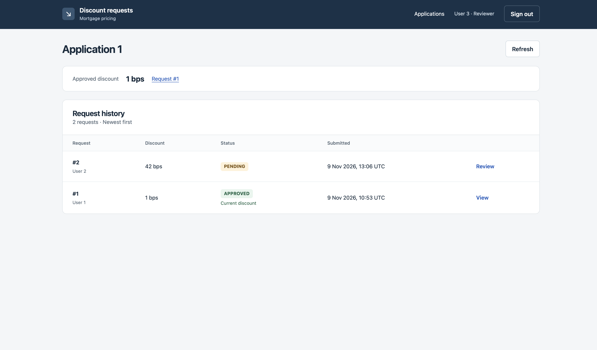

# Mortgage pricing exceptions

An HTTP API for requesting and reviewing discounts on mortgage interest rates.
A relationship manager submits a requested discount and a reason. A reviewer
approves or declines it, and the mortgage application process can retrieve the
approved amount. Each request records who submitted it, who decided it and when.

The API uses Python, FastAPI and SQLAlchemy with a local SQLite database.
The steps below take you through submitting a request, approving it and reading
the result. The agreed requirements and decisions are in [SPEC.md](SPEC.md);
the endpoint contracts are in [API.md](API.md).

An optional browser interface lets you submit and review requests through forms.
See [Run the Optional Frontend](#run-the-optional-frontend) to use it with this API.



## Before You Start

You need:

- **uv** to manage Python and the project's dependencies. See the
  [uv installation guide](https://docs.astral.sh/uv/getting-started/installation/),
  or use the command below for your system.
- **Git** to clone the repository. See the [Git downloads](https://git-scm.com/downloads/).
- **A browser**, if you want to try the API through its interactive documentation.

The API and its database run entirely locally on your system. No cloud account,
paid service or separate database installation is needed.

**Install uv on macOS (Terminal)**

If you already use Homebrew, run:

```bash
brew install uv
```

Alternatively, use uv's standalone installer:

```bash
curl -LsSf https://astral.sh/uv/install.sh | sh
```

**Install uv on Windows (PowerShell)**

```powershell
powershell -ExecutionPolicy ByPass -c "irm https://astral.sh/uv/install.ps1 | iex"
```

Open a new terminal after installation and check `uv --version`. The project
uses Python 3.13. During setup, uv uses an available installation or downloads
one if needed; you do not need to install Python separately.

## Run Locally

### 1. Clone the Repository

```bash
git clone https://github.com/emfrg/blue-harvest-assignment.git
cd blue-harvest-assignment
```

If you already have the repository, open a terminal in its root folder.

### 2. Install the Dependencies

From the repository root, run these commands on either macOS or Windows:

```sh
uv sync --locked
uv run pre-commit install
```

`uv sync` creates a `.venv` folder and installs the API dependencies and
development tools recorded in `uv.lock`. The `--locked` option checks that the
lockfile matches `pyproject.toml`.

`uv run` runs a command using that environment, so you do not need to activate
it manually. The second command installs the checks that run before each local
commit.

### 3. Create the Database and Sample Records

```bash
uv run python -m app.init_db
```

Expect `Database ready:` followed by the path to `data/requests.sqlite3`.
If the SQLite database file does not exist, this command creates it. It also
sets up the tables and adds two sample mortgage applications and four sample
users. It does not create discount requests.

Run this setup before using the mortgage endpoints. Rerunning it adds missing
sample records and preserves existing data. It does not update existing sample
records or migrate tables after a model change. The database file is ignored by Git.

To remove previous requests and start again, follow
[Reset the Local Database](#reset-the-local-database).

### 4. Start the API

```bash
uv run uvicorn app.main:app --reload --reload-dir app
```

Open [http://127.0.0.1:8000/docs](http://127.0.0.1:8000/docs).
The page lists the endpoints and lets you call them from your browser.

You can also call the API with **curl** from a second terminal. For example,
read the request history for application `1`:

**macOS (Terminal)**

```bash
curl -i -H "X-User-Id: 1" http://127.0.0.1:8000/applications/1/requests
```

**Windows (PowerShell)**

```powershell
curl.exe -i -H "X-User-Id: 1" http://127.0.0.1:8000/applications/1/requests
```

Expect HTTP **200** with a JSON response containing the application's requests.
On a fresh database, the `requests` list is empty. All endpoints can be called
with curl; [API.md](API.md) describes their headers and request bodies.

Uvicorn runs the API server in this terminal. The `--reload --reload-dir app`
options restart it when Python files in `app/` change. Press `Ctrl+C` to stop it.
When returning later, run the same server command from the repository root.
uv prepares the environment for the command. You do not need to recreate the
database each time.

## Try the API

Setup provides these records:

| Record | IDs | Use |
|---|---|---|
| Mortgage applications | `1`, `2` | Applications for which you can request a discount. |
| Relationship managers | `1`, `2` | Submit requests and read results. |
| Reviewers | `3`, `4` | Approve or decline requests and read results. |

Supply the chosen user ID in the `X-User-Id` header for each mortgage operation.
In `/docs`, expand an endpoint, select **Try it out**, fill in the fields and
select **Execute**. Check the HTTP status and JSON body under **Server response**.

The walkthrough assumes application `1` has no pending request. If you repeat
it, choose unused keys for both submissions, such as `readme-25-2` and
`readme-40-2`. If a request is already pending, see the pending-request entry
under [Troubleshooting](#troubleshooting). To repeat the walkthrough from scratch,
you can [reset the local database](#reset-the-local-database) first.

### 1. Submit a Discount Request

Open **POST /requests**. Set `X-User-Id` to `1` and `Idempotency-Key` to an
unused key, such as `readme-25-1`. Use this body:

```json
{
  "application_id": 1,
  "discount_bps": 25,
  "reason": "Competitive offer"
}
```

Expect **201**, status `PENDING`, and null decision fields. Save the returned
`id`; use that value wherever the next steps ask for `request_id`.
The discount is 25 basis points, or 0.25 percentage points.

Choose a new submission key for each new request. If a call times out, resend
the same user, key and body. Repeating this submission returns **200** with the
same request ID and its current state, without creating a duplicate.

### 2. Read the Request

Open **GET /requests/{request_id}**. Enter the returned request ID and
`X-User-Id: 1`. Expect **200** with the submitted details and status `PENDING`.

### 3. Approve It

Open **POST /requests/{request_id}/decision**. Use the same request ID,
set `X-User-Id` to reviewer `3`, and send:

```json
{"outcome": "APPROVED"}
```

Expect **200**, status `APPROVED`, `reviewer_id: 3` and a populated `decided_at`.
The requested discount remains 25 basis points.

### 4. Retrieve the Approved Discount

Open **GET /applications/{application_id}/approved-discount** with
`application_id: 1` and `X-User-Id: 1`.

Expect **200**. The `approved_discount` object contains your request ID and
`discount_bps: 25`. This is the amount the mortgage application process can use.

### 5. Inspect the History

Open **GET /applications/{application_id}/requests** with `application_id: 1`
and `X-User-Id: 1`. Expect **200** with the request, its original details and
the recorded approval, reviewer and decision time.

To also try a decline, submit a new request for 40 basis points using a new key,
such as `readme-40-1`. Send `{"outcome": "DECLINED"}` as reviewer `3` for the
new request ID. History should show both requests, and the current approved
discount should still be 25 basis points.

Two additional endpoints let a frontend load its user and application choices
from the database instead of keeping hardcoded lists:

- `GET /demo/users` returns the available user IDs and their roles.
- `GET /demo/applications` returns the available mortgage application IDs.
  Supply a known user ID in the `X-User-Id` header.

In `/docs`, these endpoints are grouped under **Frontend demo**. You can complete
the request and review workflow above without using them.

## Run the Optional Frontend

The [frontend](https://github.com/emfrg/blue-harvest-frontend) provides screens
for submitting requests, approving or declining them, and reading history and
the current approved discount. It calls the same API used in the walkthrough
above and uses the same database records.

First complete [Run Locally](#run-locally), including database setup, and keep
the API running at `http://127.0.0.1:8000` in its terminal.

You also need **Node.js 22 and npm**. If they are not installed, install Node.js
22 from the [Node.js downloads](https://nodejs.org/en/download); npm is included.
Check `node --version` and `npm --version` in a new terminal. If the repositories
are private, your GitHub account needs access to both this repository and the
frontend repository.

### 1. Download the Frontend

Open a second terminal in the `blue-harvest-assignment` root folder. Run this
command on either macOS or Windows:

```sh
git submodule update --init frontend
```

This downloads the frontend into `frontend/`. A Git submodule keeps its code
and history in a separate repository while recording the exact version to use
with this project. After pulling updates to this repository, run the same
command to load its recorded frontend version.

### 2. Install the Frontend Dependencies

From the same root folder, run:

```sh
npm --prefix frontend ci
```

This installs the versions recorded in the frontend's `package-lock.json`.
The `--prefix frontend` option tells npm to use the `frontend/` folder.

### 3. Start the Frontend

```sh
npm --prefix frontend run dev
```

Open [http://127.0.0.1:3000](http://127.0.0.1:3000). Keep both server terminals
open while using the application. Press `Ctrl+C` in each terminal to stop its
server. When returning later, start the API and frontend again; dependency
installation is only needed when setting up or after dependencies change.

The frontend connects to the API at `http://127.0.0.1:8000` by default. If you
run the API at another address, follow the `BACKEND_URL` instructions in the
[frontend README](https://github.com/emfrg/blue-harvest-frontend#3-start-the-frontend).

### 4. Try a Request and Review

1. Select **User 1 — Relationship manager** and sign in.
2. Open **Application 1**, select **New request**, enter a discount and reason,
   and submit it. The new request should appear as **PENDING**.
3. Sign out, then sign in as **User 3 — Reviewer**. Open the same application
   and select **Review** on the pending request. Approve or decline it.
4. Inspect the history and approved discount. An approval makes that request's
   discount current. A decline leaves any earlier approved discount unchanged.

If the application already has a pending request from the API walkthrough,
review that request first. Use **Refresh** to load changes made in another tab
or through the API. Both interfaces work with the same saved records.

The [frontend README](https://github.com/emfrg/blue-harvest-frontend#run-tests-and-quality-checks) explains
its TypeScript checks and browser tests.

## Reset the Local Database

Use these steps when you want to start the walkthrough again with fresh data.
This deletes all local database records, including requests, decisions and
submission keys. Setup then recreates the sample applications and users.
Running `init_db` on its own preserves existing records.

1. Stop the API with `Ctrl+C` in its terminal. Close the database in any SQLite
   browser you have open.
2. From the repository root, delete the database file using the command for
   your system.

**macOS (Terminal)**

```bash
rm data/requests.sqlite3
```

**Windows (PowerShell)**

```powershell
Remove-Item data/requests.sqlite3
```

3. Recreate the database and start the API again:

```sh
uv run python -m app.init_db
uv run uvicorn app.main:app --reload --reload-dir app
```

The database now contains the two sample applications and four sample users,
with no discount requests or saved submission keys. Open `/docs` again and
start at [Submit a Discount Request](#1-submit-a-discount-request). You can
use `readme-25-1` again because the previous data has been removed.

## Run Tests and Quality Checks

From the repository root, run these commands on either system:

```sh
uv run pytest
uv run pre-commit run --all-files
```

Tests create temporary SQLite databases, so they do not modify
`data/requests.sqlite3`. They exercise the request workflow, validation and
permissions, duplicate submissions, competing decisions and persistence.

The pre-commit checks cover Ruff formatting, Ruff linting and strict mypy type
checking for `app/` and `tests/`. They report problems without rewriting files.
To apply formatting corrections, run:

```bash
uv run ruff format app tests
```

Review the changes and rerun the checks. Once installed, these hooks block a
local commit if a check fails. They use `uv run --locked` to run the tools in
the project's environment and require an up-to-date lockfile. Pytest runs
separately. Each new checkout needs the `uv run pre-commit install` step.

### Change Dependencies

`pyproject.toml` lists the API dependencies and a `dev` group for test and checking
tools. `uv.lock` records the exact resolved versions, including the packages
those dependencies need.

Use these commands when changing dependencies. Replace `PACKAGE` with the
package name:

| Change | Command |
|---|---|
| Add an API dependency | `uv add PACKAGE` |
| Add a development tool | `uv add --dev PACKAGE` |
| Remove an API dependency | `uv remove PACKAGE` |
| Remove a development tool | `uv remove --dev PACKAGE` |

To choose a specific version, include it in the argument, for example
`uv add "fastapi==0.162.0"`. This also works when changing the version of an
existing dependency.

uv updates `pyproject.toml`, `uv.lock` and the environment together. Review the
changes, rerun the tests and quality checks, and commit both files together.
Let uv generate the lockfile. After pulling dependency changes from Git, run
`uv sync --locked` to install the recorded versions. See
[uv's dependency guide](https://docs.astral.sh/uv/concepts/projects/dependencies/)
for more options.

## Assumptions and Scope

### Users and Access

Setup creates sample users and mortgage applications. For each mortgage operation,
you send a user ID in `X-User-Id`. The API checks that the user exists and that
their role allows the action.

There is no login or password check. Anyone calling the local API can send any
of the sample user IDs. Company login integration and cloud deployment are
outside the scope of this assignment.

### Requests and Decisions

Once a request is submitted, its application ID, discount and reason cannot be
edited. An approval is specific to that request and its requested discount.

Each mortgage application can have only one request waiting for a decision.
To change a request that is still pending, a reviewer must first decline it.
The relationship manager can then submit a new request with the changed details.

If an application already has an approved discount, that discount stays active
while a new request is pending. It also stays active if the new request is declined.
If the new request is approved, the newly approved discount becomes the active
discount for that application.

The history lists all requests, including earlier approvals and declines. For
each decision, it shows who made it and when.

Discounts must be positive whole numbers of basis points. The full business rules
and acceptance examples are in [SPEC.md](SPEC.md).

### Database Access

SQLite allows only one database operation to write at a time. If an operation
fails because the database is busy, the API tries again. If the database is
still busy after three attempts, the API returns `503`.

The concurrency tests check specific situations, such as two reviewers trying to
decide the same request at the same time. They do not measure how much traffic
the API can handle. See [API.md](API.md#sqlite-concurrency-limits-and-postgresql)
for the database limitations and the comparison with PostgreSQL.

## Before Production Use

Before using this with real mortgage applications, I would address the following:

- **Authentication and endpoint access.** Connect to the company's login system
  and apply the existing endpoint permissions to the signed-in user. Managers
  submit requests, reviewers approve or decline them, and both roles can read
  requests, history and approved discounts.

- **Containerized deployment.** Package the API and frontend as Docker images.
  Supply configuration and secrets through the deployment environment, and keep
  database storage separate from disposable containers.

- **PostgreSQL and workload testing.** Replace SQLite with PostgreSQL, run the
  existing workflow and concurrency tests against it, and check response times
  and errors under the expected traffic.

- **Database updates and recovery.** Use [Alembic](https://alembic.sqlalchemy.org/en/latest/)
  to manage changes to existing tables. Automate backups and test that restoring
  them preserves request history and approved discounts.

## Further Development

- **Let managers withdraw pending requests.** A manager may request 25 basis
  points, then agree 30 with the customer before review. Allowing withdrawal would
  let them submit the new request without waiting for a reviewer to decline the
  original. Keep the withdrawn request in the history.

- **Record decision reasons.** Let reviewers explain why they approved or declined
  a request, so someone reading the history can understand the decision.

- **Add pricing validation.** Define discount limits with the business, for
  example a maximum permitted discount. Validate new requests against those limits.

- **Adopt the full Spec Kit workflow.** Build on this project's manual use of SPEC
  by integrating [GitHub Spec Kit](https://github.com/github/spec-kit)'s templates,
  agent instructions and commands for specification, planning, tasks,
  implementation and verification. The aim is to make continued development
  easier and faster, with less repeated prompting and human review at each stage.

## Project Files

| File or directory | Where to look |
|---|---|
| [SPEC.md](SPEC.md) | Agreed behaviour, acceptance scenarios and decision history. Start here when changing requirements. It also explains the specification's preparation and AI contribution. |
| [API.md](API.md) | Endpoints, request and response fields, error codes and transaction handling. |
| [app/main.py](app/main.py) | Application startup and shutdown, router registration and the health endpoint. |
| [app/api.py](app/api.py) | HTTP routes, headers and generated API documentation. |
| [app/schemas.py](app/schemas.py) | Input validation and response shapes. |
| [app/operations.py](app/operations.py) | Business operations, access checks and transaction retries. |
| [app/models.py](app/models.py) | Database tables, fields and constraints. |
| [app/database.py](app/database.py), [app/init_db.py](app/init_db.py) | Database connections, sessions and initial setup with sample records. |
| [tests/](tests/) | API, concurrency, model, database and health checks. Shared fixtures are in `conftest.py`. |
| [frontend/](https://github.com/emfrg/blue-harvest-frontend) | Optional browser interface, included as a Git submodule. Its README covers frontend development and tests. |
| [.gitmodules](.gitmodules) | The frontend repository URL and its location in this checkout. |
| [pyproject.toml](pyproject.toml), [uv.lock](uv.lock), [.python-version](.python-version) | Dependencies, their resolved versions, the Python version, and Ruff/mypy configuration. |
| [.pre-commit-config.yaml](.pre-commit-config.yaml) | Formatting, linting and type checks run before commits. |
| [pytest.ini](pytest.ini) | Test discovery and the project import path. |

## Troubleshooting

| Problem | What to check |
|---|---|
| `uv` is not found | Install uv using the steps above, open a new terminal and check `uv --version`. |
| A command reports that the lockfile needs updating | After an intentional dependency edit, use `uv lock`, review the lockfile changes and run `uv sync --locked`. For a fresh checkout, check that `pyproject.toml` and `uv.lock` came from the same revision. |
| `ModuleNotFoundError` | Run `uv sync --locked` from the repository root, then use the `uv run` command shown above. |
| Mortgage endpoints fail with a missing-table error in the server log | Run `uv run python -m app.init_db` from the repository root. A successful `/health` response only confirms that the API responds; it does not check database readiness. |
| Port 8000 is already in use | Use `uv run uvicorn app.main:app --reload --reload-dir app --port 8001` and open `http://127.0.0.1:8001/docs`. |
| `403` | Check that `X-User-Id` exists and has the required role. Use a manager to submit and a reviewer to decide. |
| `422` | Read the response's `detail` field for the invalid or missing input. Supply the required headers and a positive integer discount. |
| `409`: application already has a pending request | Read that application's history. Review the pending request before submitting another. If you intended to change it, decline it first and submit the changed details with a new key. |
| `409`: retry key already used with different details | Use the original body for a retry. For a new request, use a new key and ensure the application has no pending request. |
| `409`: request already decided | The saved decision cannot be changed. Further consideration requires a new request. |
| `503` | Another database operation may still be holding a lock. Try again after it finishes. For a submission retry, keep the original user, key and body. |

For other response details, see [Validation and errors](API.md#validation-and-errors).
